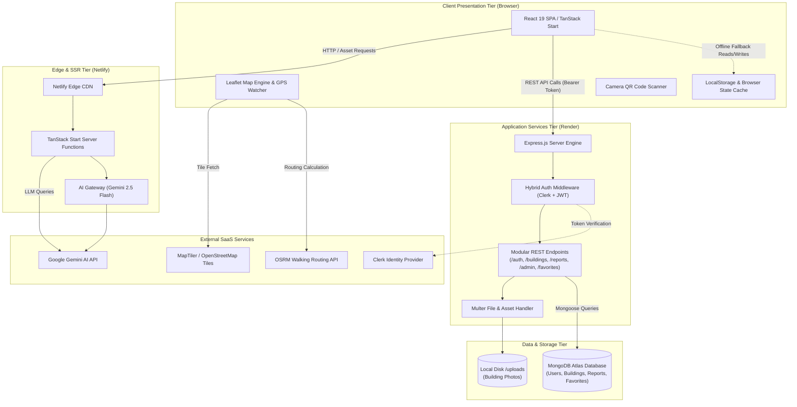
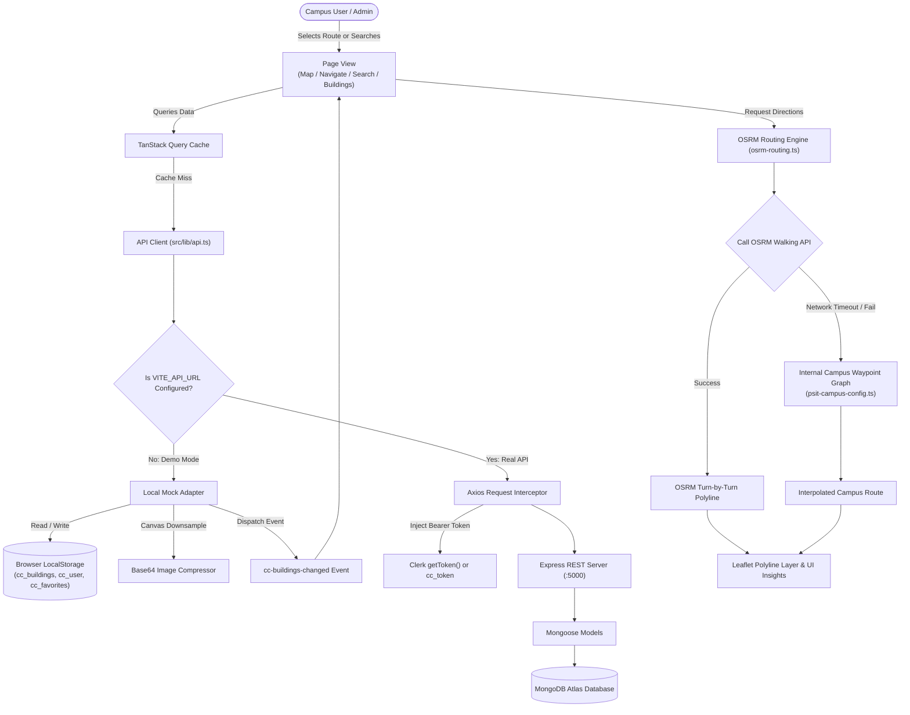
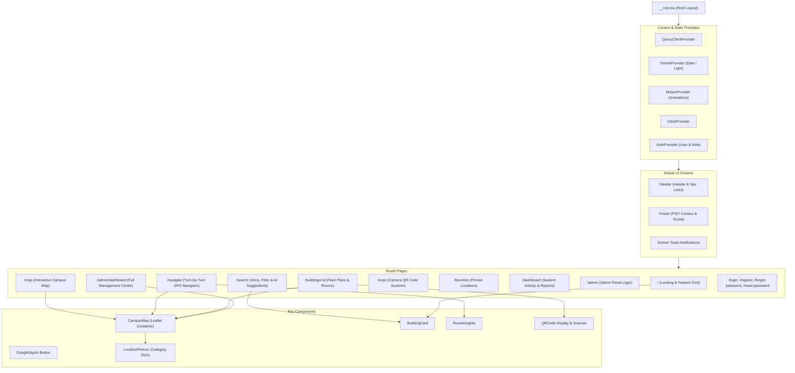
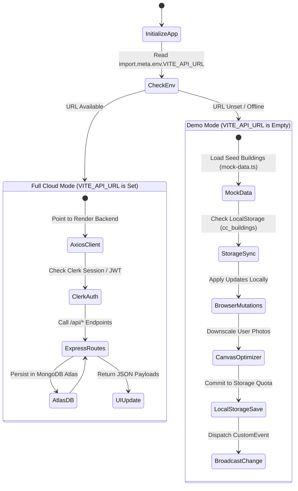
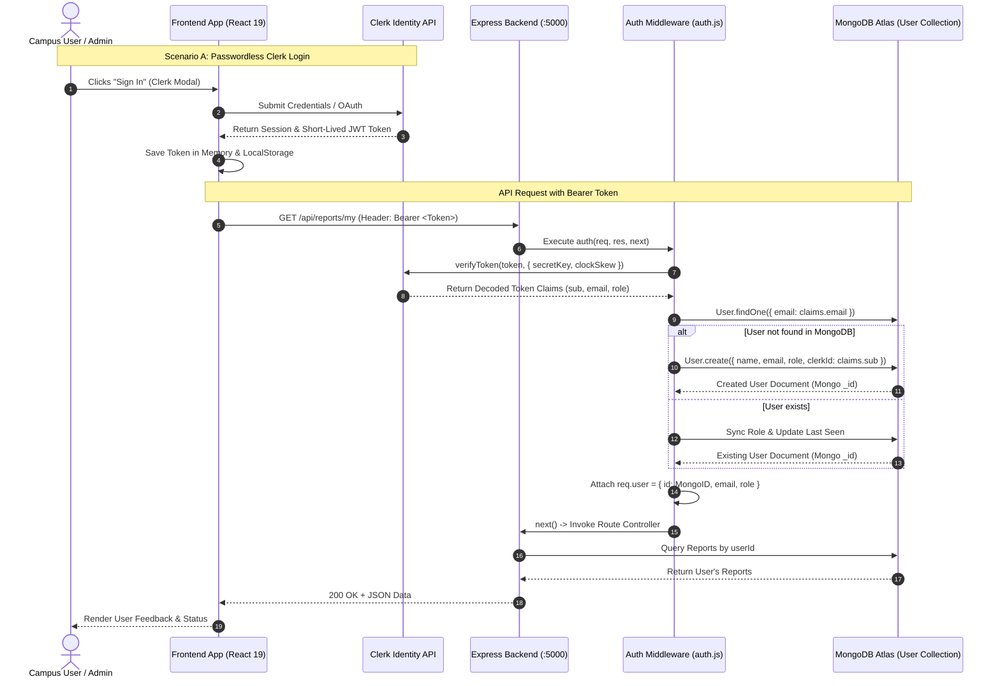
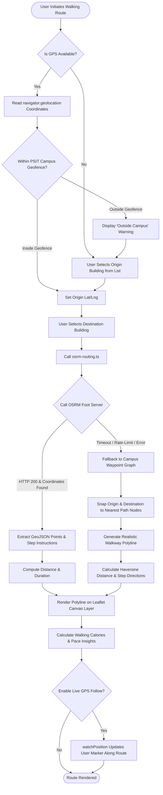
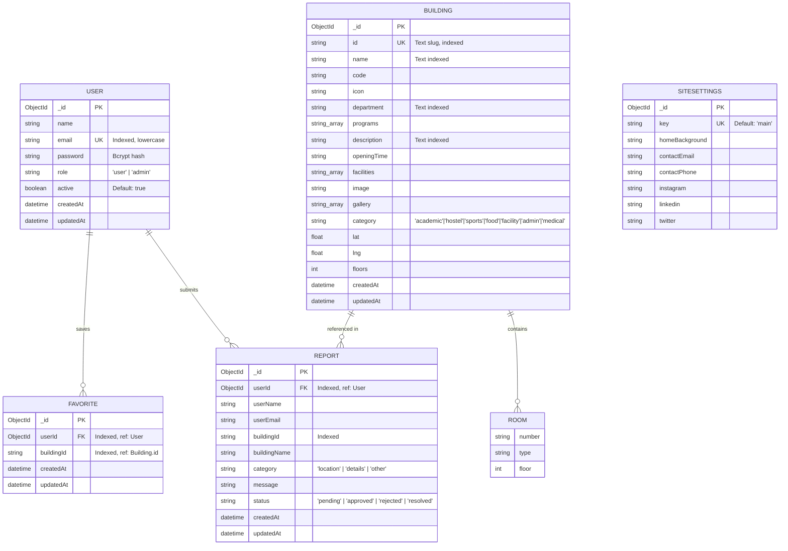
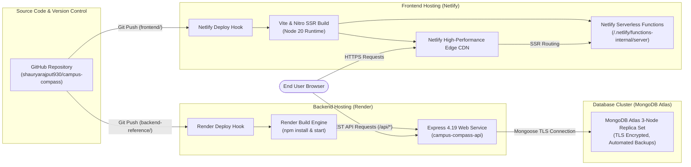

# 📊 Campus Compass — Architecture Diagrams

This document provides visual architectural diagrams, flowcharts, and sequence models illustrating the components, data pipelines, authentication lifecycles, and deployment topologies of **Campus Compass**.

---

## 📑 Diagram Index

1. [High-Level System Architecture](#1-high-level-system-architecture)
2. [End-to-End Component Interaction & Data Flow](#2-end-to-end-component-interaction--data-flow)
3. [Frontend Route & Component Hierarchy](#3-frontend-route--component-hierarchy)
4. [Hybrid Data Layer: Real API vs Demo Mode](#4-hybrid-data-layer-real-api-vs-demo-mode)
5. [Authentication & Authorization Sequence](#5-authentication--authorization-sequence)
6. [Navigation & Routing Subsystem Flowchart](#6-navigation--routing-subsystem-flowchart)
7. [Database Entity Relationship Diagram (ERD)](#7-database-entity-relationship-diagram-erd)
8. [DevOps & Cloud Deployment Infrastructure](#8-devops--cloud-deployment-infrastructure)

---

## 1. High-Level System Architecture

This diagram shows the high-level tier breakdown from the user's browser down to persistence and third-party SaaS providers.

---

## 2. End-to-End Component Interaction & Data Flow

This diagram illustrates how data flows between UI views, internal helper libraries, local storage, the backend API, and external routing services.

---

## 3. Frontend Route & Component Hierarchy

This diagram details the nested component and layout structure across the TanStack Router tree.

---

## 4. Hybrid Data Layer: Real API vs Demo Mode

Campus Compass is engineered to run seamlessly with zero configuration (offline demo mode) or as a distributed cloud system.

---

## 5. Authentication & Authorization Sequence

This sequence diagram depicts how authentication credentials flow and synchronize user accounts between Clerk, local JWT storage, and MongoDB.

---

## 6. Navigation & Routing Subsystem Flowchart

This flowchart demonstrates the turn-by-turn calculation and fallback logic executed during campus walking directions.

---

## 7. Database Entity Relationship Diagram (ERD)

This entity relationship diagram outlines the database entities, field types, relationships, and compound indexes.

---

## 8. DevOps & Cloud Deployment Infrastructure

This diagram presents the cloud hosting topology, deployment automation pipelines, and network ingress paths.

